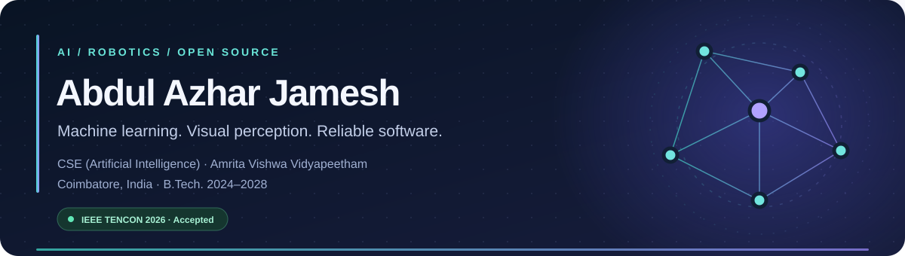

  

  <a href="https://www.linkedin.com/in/abdul-azhar-jamesh-410a43291/"><strong>Connect on LinkedIn</strong></a> &nbsp; / &nbsp;
  <a href="#open-source-contributions">Open source</a> &nbsp; / &nbsp;
  <a href="#selected-work">Projects</a> &nbsp; / &nbsp;
  <a href="#education">Education</a>

---

## About me

I'm an AI undergraduate based in Coimbatore, India. I work on projects involving visual perception, neural network compression, mathematical optimization, and software verification. I enjoy connecting the underlying algorithms to code that can be tested and reproduced.

My coursework and projects also cover data structures and algorithms, generative AI, large language models, and retrieval augmented generation.

## Open-source contributions

I contribute bug fixes to tools I use, from editor behavior and API clients to robotics frameworks.

| Project | Contribution | Status |
| --- | --- | --- |
| **Aerostack2** | [Handle unset behavior results and goals in the Python API](https://github.com/aerostack2/aerostack2/pull/1059) | **Merged** · November 2026 |
| **Microsoft Kiota Python** | [Generate a new multipart boundary for each instance](https://github.com/microsoft/kiota-python/pull/886) | **Merged** · November 2026 |
| **Meta Lexical** | [Preserve the first block after backward range deletion](https://github.com/meta/lexical/pull/9236) | **Merged** · September 2026 |
| **openZIM Gutenberg** | [Show the author's book count in the book details view](https://github.com/openzim/gutenberg/pull/596) | **Merged** · September 2026 |
| **Bruno** | [Show hidden filename validation errors when creating a request](https://github.com/usebruno/bruno/pull/9812) | **Open** · under review |

PR states checked on 16 November 2026. Links lead to the upstream discussions and changes.

<strong>More contribution work: Checkstyle</strong>

Prepared a [fix for superclass field access being mistaken for a method call](https://github.com/Abdul-Azhar-Jamesh/checkstyle/commit/35d5d6fa90d63ff504bcdcdd36fef4b21b4fe482), related to [Checkstyle issue #22795](https://github.com/checkstyle/checkstyle/issues/22795). This is a commit on my fork; it is not listed as a merged upstream contribution.

## Selected work

<table>
<tr>
<td width="50%" valign="top">
<h3>01 / Robotic Fish Navigation</h3>

Underwater perception and steering with YOLOv8, adaptive image enhancement, artificial potential fields, and IMU feedback.

<strong>Research accepted at IEEE TENCON 2026.</strong>

<a href="https://github.com/Abdul-Azhar-Jamesh/Vission-based-obstacle-tracking-and-avoidance">Explore the project &rarr;</a>

</td>
<td width="50%" valign="top">
<h3>02 / Probabilistic Constraint Graphs</h3>

Experimental Python code review combining dependency graphs, Bayesian inference, and test evidence.

<strong>Python · Bayesian inference · Software testing</strong>

<a href="https://github.com/Abdul-Azhar-Jamesh/Probabilistic-Constraint-Graphs-PCG-for-Uncertainty-Aware-Code-Verification">Explore the project &rarr;</a>

</td>
</tr>
<tr>
<td width="50%" valign="top">
<h3>03 / Human Activity Recognition</h3>

A reproducible BiLSTM and Transformer comparison on UCI HAR smartphone sensor data.

<strong>PyTorch · TensorFlow · Time series</strong>

<a href="https://github.com/Abdul-Azhar-Jamesh/Transformer-BiLSTM-Human-Activity-Recognition">Explore the project &rarr;</a>

</td>
<td width="50%" valign="top">
<h3>04 / Low-Bit Neural Networks</h3>

Team experiments in ADMM-based CNN quantization for efficient inference.

<strong>PyTorch · MATLAB · Optimization</strong>

<a href="https://github.com/Abdul-Azhar-Jamesh/MFC4_D4_MFC4_LowBitNNs">Explore the project &rarr;</a>

</td>
</tr>
</table>

<strong>More collaborative projects</strong>

- [Sparse Portfolio Optimization](https://github.com/Abdul-Azhar-Jamesh/MFC3_D9_Sparse_Portfolio_Optimization): a team project applying ADMM to asset selection and sparse portfolio weights.
- [Federated sepsis prediction](https://github.com/Abdul-Azhar-Jamesh/Privacy-Preserving-Neuro-Symbolic-Edge-System-for-Real-Time-Health-Monitoring-): collaborative work on neuro-symbolic learning, federated training, and ICU monitoring.

## Education

| Qualification | Institution | Year | Academic result |
| --- | --- | --- | --- |
| B.Tech., Computer Science & Engineering (Artificial Intelligence) | Amrita Vishwa Vidyapeetham, Coimbatore | 2024–2028, expected | CGPA: 8.0/10 |
| Class XII, CBSE | BVM Global School, Coimbatore | 2024 | 90% |
| Class X, CBSE | J S S Public School, Ooty | 2022 | 80% |

## Tools I use

| Area | Technologies |
| --- | --- |
| Programming | Python, Java, C, C++ |
| Machine learning and vision | PyTorch, scikit-learn, YOLOv8, OpenCV |
| Scientific computing | MATLAB, ADMM and numerical optimization |
| Development | Git, GitHub, SQL |

## Certifications

- Machine Learning Specialization — DeepLearning.AI / Coursera, April 2026.
- Generative AI with Large Language Models — DeepLearning.AI / Coursera, March 2026.
- Retrieval Augmented Generation (RAG) — DeepLearning.AI.

## Connect

Interested in discussing machine learning, computer vision, or research projects? [Connect with me on LinkedIn](https://www.linkedin.com/in/abdul-azhar-jamesh-410a43291/).
